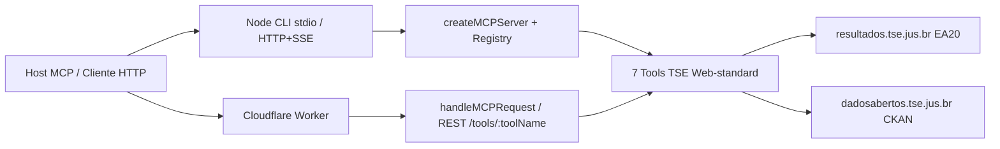

# Arquitetura AS-IS

Base inicial: `v0.1.0` (`SPC-0001`, `ADR-0001`).

O pacote compartilha um núcleo Web-standard (`lib/shared/`, `lib/tools/`, `lib/core/`, `lib/infrastructure/`) entre dois runtimes:
1. **Node.js CLI (`lib/adapters/cli.ts` + `lib/adapters/cli-http.ts`):** transportes `stdio` e `HTTP/SSE`, cache em memória (`MemoryCache`), rate limiting por sessão e por IP, graceful shutdown e `AsyncLocalStorage<RequestContext>`.
2. **Cloudflare Workers (`lib/adapters/cloudflare.ts` + `lib/workers/*`):** endpoints `/`, `/health`, `/openapi.json`, `/mcp`, `/sse` e `POST /tools/{toolName}` com `KVCache`, rate limiting em `MCP_KV`, autenticação `MCP_API_KEY` e propagação de `X-Request-Id`.

## Fontes

- `lib/core/mcp-server.ts`
- `lib/core/registry.ts`
- `lib/core/tools.ts`
- `lib/adapters/cli.ts`
- `lib/adapters/cli-http.ts`
- `lib/adapters/cloudflare.ts`
- `lib/workers/worker.ts`
- `lib/workers/rest.ts`
