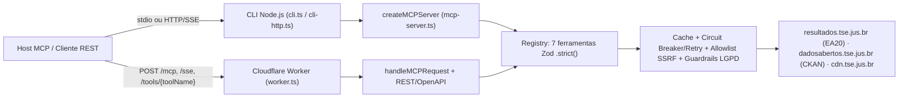

# MCP TSE `by Orqo`

**Dados eleitorais brasileiros na conversa com IA. Com fonte, proveniência e limites declarados.**

[](https://orqo.pro/)
[](https://www.npmjs.com/package/@aredes.me/mcp-tse)
[](LICENSE)
[](package.json)
[](#catálogo-completo-das-7-ferramentas)

[O problema](#o-problema) · [7 ferramentas](#catálogo-completo-das-7-ferramentas) · [Ecossistema](#sinergia-no-ecossistema-aredesme) · [Perímetro](#perímetro-de-execução) · [Instalação](#instalação-e-configuração) · [Por dentro](#como-funciona-por-dentro) · [O que não faz](#honestidade-o-que-o-mcp-tse-não-faz) · [Governança](#governança-construído-com-codebase-ops-by-orqo) · [AGPL-3.0](#licença-gnu-agpl-30) · [Privacidade](#privacidade-e-lgpd) · [English](#english)

---

O **MCP TSE** (`@aredes.me/mcp-tse`) é um servidor open source do [Model Context Protocol (MCP)](https://modelcontextprotocol.io/) desenvolvido pela [Orqo](https://orqo.pro/) que conecta assistentes de IA a **7 consultas estruturadas de dados eleitorais públicos do Tribunal Superior Eleitoral (TSE)** — cobrindo os arquivos estáticos oficiais da arquitetura **EA20** (`resultados.tse.jus.br`) e o catálogo **Dados Abertos CKAN APIv3** (`dadosabertos.tse.jus.br` / `cdn.tse.jus.br`).

- **Zero chave de API em 100% das 7 ferramentas** — catálogo de eleições, tradução TSE↔IBGE e zonas eleitorais, apuração por cargo, busca nominal de candidatos, consolidação de partidos/federações, comparecimento/abstenção e busca no CKAN funcionam sem cadastro ou token prévio.
- **Proveniência explícita, sanitização e LGPD** — toda resposta inclui `source`, `source_url`, `fetchedAt` em UTC e `untrusted_data_notice` ([`lib/shared/agentic-guard.ts`](lib/shared/agentic-guard.ts#L9-L10)), além de `lgpd_notice` obrigatório (LGPD Art. 20) nas consultas nominais de `tse_apuracao_cargo` e `tse_candidatos_busca`.
- **Paridade Node.js e Cloudflare Worker** — CLI local (`stdio` e `HTTP/SSE`) ou Worker serverless com JSON-RPC (`POST /mcp`), streaming (`GET|POST /sse`), REST direto (`POST /tools/{toolName}`), OpenAPI 3.0 (`GET /openapi.json`) e saúde (`GET /health`).
- **Software livre AGPL-3.0 com rastro público** — desenvolvido e verificado com [Codebase OPS by Orqo](https://orqo.pro/) em [`.archagents/`](.archagents/README.md).

---

## O problema

### Seu assistente sabe falar sobre eleições brasileiras. Não sabe o código TSE de um município, a totalização por seção de um pleito ou quais datasets estão publicados no portal oficial.

Pedir resultados eleitorais, números de urna ou códigos municipais "de memória" a um modelo de linguagem mistura ciclos eleitorais antigos, confunde código IBGE (7 dígitos) com código TSE (5 dígitos) e fabrica percentuais sem fonte. Para jornalismo de dados, ciência política, integridade pública ou pesquisa acadêmica, fluência textual não substitui a consulta verificável à fonte oficial.

| Pedir ao LLM "de memória" | Consultar via MCP TSE `by Orqo` |
| --- | --- |
| Código IBGE confundido com código TSE e zonas eleitorais inventadas | Tradução exata `codigo_tse` (5 dígitos) ↔ `codigo_ibge` (7 dígitos), capital e `zonas_eleitorais[]` via `mun-e*-cm.json` |
| Votação nominal, legendas, federações e vices possivelmente alucinados | Totalização oficial EA20 (`-u.json`) com seções apuradas, votos válidos/nominais/legenda, `vices_suplentes[]` e `fetchedAt` |
| Mistura entre ciclos (`ele2022`, `ele2024`, `ele2026`), turnos e pleitos suplementares | Catálogo direto de `ele-c.json` com `codigo_pleito`, `codigo_eleicao`, `codigo_segundo_turno`, `abrangencias` e `cargos` |
| Links quebrados ou tentativa frustrada de scraping em `divulgacandcontas` | Catálogo CKAN oficial (`dadosabertos.tse.jus.br`) com URLs de CSV/ZIP em `cdn.tse.jus.br` + `upstream_waf_notice` explícito |
| Texto externo não sanitizado ou decisões automatizadas sobre homônimos | Schemas Zod `.strict()`, `sanitizeUntrustedText`, `untrusted_data_notice`, `lgpd_notice` (Art. 20) e erro explícito (`isError: true`) |

---

## Experimente em uma conversa

1. **Descobrir o pleito e traduzir código IBGE ↔ TSE:**
   > *"Liste as eleições de 2024 no catálogo do TSE (`tse_eleicoes_catalogo`) e traduza o código IBGE `3106200` para código TSE e zonas eleitorais usando `tse_municipios_zonas`."*
2. **Consultar apuração paginada por cargo e seções totalizadas:**
   > *"Mostre a apuração para prefeito em Belo Horizonte (`codigo_eleicao: 619`, `ciclo: ele2024`, `uf: mg`, `codigo_tse_municipio: 41238`) com percentual de seções totalizadas, brancos/nulos e os 10 candidatos mais votados."*
3. **Buscar candidato, vice/suplente ou consolidação por partido e federação:**
   > *"Use `tse_candidatos_busca` para localizar candidatos eleitos e seus vices/suplentes na disputa informada, e compare o total nominal e de legenda em `tse_partidos_federacoes`."*
4. **Verificar comparecimento e abstenção por UF ou município:**
   > *"Consulte em `tse_comparecimento_abstencao` o eleitorado apto, o comparecimento e a taxa de abstenção agregada de `uf: sp` ou de um município específico."*
5. **Localizar datasets abertos e cruzar `codigo_ibge` e `CNPJ` no ecossistema `@aredes.me/*`:**
   > *"Pesquise pacotes de prestação de contas e candidaturas de 2024 no CKAN com `tse_dados_abertos_datasets`, use o `codigo_ibge` obtido no `mcp-tse` para cruzar despesas municipais no `@aredes.me/mcp-orcamento` e valide o CNPJ de doadores ou fornecedores de campanha com `cnpj_lookup` no `@aredes.me/mcp-dadosbr`."*

---

## Catálogo completo das 7 ferramentas

Todas as 7 ferramentas registradas em [`lib/tools/index.ts`](lib/tools/index.ts) validam entradas com schemas Zod `.strict()` sem `api_key` ([`lib/shared/tse-schemas.ts`](lib/shared/tse-schemas.ts)), respondem em **JSON textual estruturado** (`content[0].text` limitado por `MCP_MAX_TOOL_OUTPUT_CHARS`, padrão `100000` caracteres) e **não expõem painéis HTML `ui://` (MCP Apps)** — garantindo comportamento idêntico em `stdio`, `HTTP/SSE` e Cloudflare Workers.

### Catálogo eleitoral e geografia (2)

| Ferramenta | Parâmetros e limites principais | Fonte oficial | Retorno e avisos |
| --- | --- | --- | --- |
| `tse_eleicoes_catalogo` | `ano` (`2014`–`2034`), `tipo` (`ordinaria` \| `suplementar` \| `todas`, padrão `todas`), `uf` (`br` ou UF), `limit` (`1`–`50`, padrão `20`) | `resultados.tse.jus.br` (`comum/config/ele-c.json`) | `eleicoes[]` com códigos de pleito/eleição/2º turno, abrangências e cargos; `source_url`, `fetchedAt`, `untrusted_data_notice` |
| `tse_municipios_zonas` | `ciclo` (padrão `ele2024`), `codigo_eleicao` (padrão `619`), ao menos 1 filtro entre `uf` (`!= br`), `codigo_ibge` (7 dígitos), `codigo_tse` (5 dígitos) ou `nome` (`2`–`120` chars); `limit` (`1`–`50`, padrão `25`) | `resultados.tse.jus.br` (`mun-e{ele6}-cm.json`) | `municipios[]` com `codigo_tse`, `codigo_ibge`, `nome`, `uf`, `capital` e `zonas_eleitorais[]` |

### Apuração, candidaturas, partidos e comparecimento EA20 (4)

| Ferramenta | Parâmetros e limites principais | Fonte oficial | Retorno e avisos |
| --- | --- | --- | --- |
| `tse_apuracao_cargo` | `cargo` (obrigatório: `presidente`, `governador`, `senador`, `deputado_federal`, `deputado_estadual`, `deputado_distrital`, `prefeito`, `vereador`), `ciclo` (`ele2026`), `codigo_eleicao` (`6257`), `uf` (obrigatória para cargos estaduais/municipais), `codigo_tse_municipio` (obrigatório para `prefeito`/`vereador`), `page` (`1`–`100`), `limit` (`1`–`50`, padrão `25`) | EA20 `-u.json` (`dados/{uf}/{prefix}-c{cargo}-e{ele6}-u.json`) | Resumo de `secoes`, `eleitorado`, `votos`, `pagination`, `candidatos[]` ordenados por votos + `vices_suplentes[]`, **`lgpd_notice` (Art. 20)** e `untrusted_data_notice` |
| `tse_candidatos_busca` | Mesmo escopo de `tse_apuracao_cargo` + filtros `nome` (`2`–`120` chars, busca titular e `vices_suplentes[]`), `numero` (`2`–`5` dígitos), `partido` (`1`–`30` chars), `apenas_eleitos` (boolean, padrão `false`), `limit` (`1`–`50`, padrão `20`) | EA20 `-u.json` | `candidatos[]` filtrados com `sq_candidato`, situação, votos, `vices_suplentes[]`, **`lgpd_notice` (Art. 20)** e `untrusted_data_notice` |
| `tse_partidos_federacoes` | Mesmo escopo de `tse_apuracao_cargo` + `partido` opcional (sigla, nome ou número, `1`–`30` chars), `limit` (`1`–`50`, padrão `25`) | EA20 `-u.json` | `federacoes[]` (`composicao`, `numeros_partidos`) e `partidos[]` (`tvtn`, `tvan`, `votos_legenda`, `total_candidatos`, `total_eleitos`) |
| `tse_comparecimento_abstencao` | `ciclo` (`ele2026`), `codigo_eleicao` (`6257`), `uf` (`br` padrão ou UF), `codigo_tse_municipio` (5 dígitos; exige `uf != br`) | EA20 `-ab.json` (`dados/{uf}/{uf}-e{ele6}-ab.json`) | `resumo_agregado` (quando sem município) e `abr[]` limitado a **100 entradas** ([`MAX_AB_RETURNED`](lib/tools/tse-resultados.ts#L38)) com `truncated` e `truncation_notice` |

### Dados abertos CKAN e cruzamento investigativo (1)

| Ferramenta | Parâmetros e limites principais | Fonte oficial | Retorno e avisos |
| --- | --- | --- | --- |
| `tse_dados_abertos_datasets` | `query` (`1`–`200` chars), `package_id` (slug `[a-z0-9_-]{3,120}` para `package_show`), `ano` (`2014`–`2034`), `rows` (`1`–`25`, padrão `10`) | `dadosabertos.tse.jus.br/api/3/action/` (`package_search` / `package_show`) | Pacotes CKAN e URLs CSV/ZIP em `cdn.tse.jus.br` (até `10` recursos/pacote na busca; `50` no `package_show`), `cross_mcp_hint` (`@aredes.me/mcp-dadosbr`), `upstream_waf_notice` e `untrusted_data_notice` |

> **Contrato textual e ausência de `ui://`:** conforme [`lib/core/mcp-server.ts`](lib/core/mcp-server.ts#L85-L91), `resources/list` retorna `[]` e `resources/read` falha fechado (`Unknown resource URI`). Toda resposta bem-sucedida devolve JSON serializado em `content[0].text`; falhas de validação Zod ou erro HTTP upstream retornam `isError: true` (JSON-RPC `-32602` / `-32603` no Worker) e **nunca são gravadas no cache**.

---

## Sinergia no ecossistema `@aredes.me/*`

Cada servidor do portfólio mantém escopo enxuto e Worker-safe para trabalhar em conjunto no mesmo cliente MCP:

| Servidor MCP | Papel na análise pública | Ponte prática com o `mcp-tse` |
| --- | --- | --- |
| **`@aredes.me/mcp-tse`** | Catálogo de pleitos, zonas, apuração EA20, candidaturas, partidos e pacotes CKAN | Ponto de partida eleitoral; fornece `codigo_ibge` (`tse_municipios_zonas`) e links de prestação de contas (`tse_dados_abertos_datasets`) |
| **`@aredes.me/mcp-dadosbr`** | Cadastro de empresas (`cnpj_lookup`), sanções CEIS/CNEP/TCU, IBGE, PNCP e Querido Diário | Recomendado pelo próprio `CROSS_MCP_CNPJ_HINT` ([`lib/tools/tse-ckan.ts`](lib/tools/tse-ckan.ts#L22-L23)) para auditar CNPJs de doadores e fornecedores de campanha |
| **`@aredes.me/mcp-orcamento`** | Orçamento público, receitas e despesas federais/subnacionais | Recebe o `codigo_ibge` (7 dígitos) traduzido pelo `mcp-tse` para cruzar geografia eleitoral com execução orçamentária |
| **`@aredes.me/mcp-camara` & `@aredes.me/mcp-senado`** | Proposições, votações nominais e atividade parlamentar no Congresso Nacional | Continua o acompanhamento de deputados federais e senadores eleitos após a apuração obtida no `mcp-tse` |

---

## Perímetro de execução

### A mesma disciplina de dados e segurança, no runtime que a sua operação exigir.

| Modo | Transporte / Rotas | MCP Apps (`ui://`) | Retorno JSON textual | Controles inclusos | Quando escolher |
| --- | --- | --- | --- | --- | --- |
| **CLI local (padrão)** | `stdio` | Não (`resources: []`) | Sim (7 ferramentas) | `stdout` exclusivo para JSON-RPC, `MemoryCache` (256 / 1h), rate limit de sessão (`120 req/min`), retry + circuit breaker por origem, allowlist SSRF | Uso local no Claude Desktop, Cursor, Windsurf, Claude Code e Codex |
| **CLI HTTP/SSE local** | `GET /mcp` + `POST /messages` | Não (`resources: []`) | Sim (7 ferramentas) | Rate limit HTTP (`30 req/min` por IP), limpeza de sessões SSE (`MCP_MAX_SSE_SESSIONS=100`), validação `Host`/`Origin` anti-DNS-rebinding, `MCP_API_KEY` obrigatória fora de loopback | Rede local, Docker, VPS própria ou clientes MCP remotos compatíveis com SSE |
| **Cloudflare Worker** | `POST /mcp`, `GET\|POST /sse`, `POST /tools/{toolName}`, `GET /openapi.json`, `GET /health`, `GET /` | Não | Sim (JSON-RPC, SSE e REST + OpenAPI 3.0) | Auth `MCP_API_KEY` *constant-time*, rate limit em `MCP_KV` (`30 req/min`), `KVCache` (`MCP_CACHE`, TTL mínimo `60s`), `/oauth/*` *fail-closed* (`501`) | Conectores serverless na borda, integrações REST e pipelines automatizados |

> **Autenticação obrigatória fora de loopback (`MCP_API_KEY`):** por padrão, o modo `HTTP/SSE` escuta em `127.0.0.1` ([`lib/adapters/cli.ts`](lib/adapters/cli.ts#L109-L123)). Ao definir `MCP_HTTP_HOST` para um endereço não-loopback (`0.0.0.0`, `::`, IP de rede), o servidor opera em modo **fail-closed** e recusa iniciar sem `MCP_API_KEY` ([`lib/adapters/cli-http.ts`](lib/adapters/cli-http.ts#L233-L245)). Com `MCP_API_KEY` ativa, envie `Authorization: Bearer <chave>` ou `X-API-Key: <chave>`.

**O que não muda entre os modos:**

- Validação de entrada com Zod `.strict()` e allowlist HTTPS para hosts configuráveis do TSE (mitigação SSRF).
- Retorno textual JSON limitado por `MCP_MAX_TOOL_OUTPUT_CHARS` (`100000` chars por padrão).
- Nunca armazena respostas de erro HTTP ou payloads inválidos no cache.
- Preservação de `untrusted_data_notice`, `lgpd_notice` (Art. 20) e `upstream_waf_notice`.

---

## Instalação e configuração

**Pré-requisito:** Node.js **22.12 ou posterior na linha 22**, **24** ou **26** (`engines.node` em [`package.json`](package.json#L76-L78)).

### 1. Início rápido via npm

Em clientes com suporte a `mcpServers` (Claude Desktop, Cursor, Windsurf, Claude Code e compatíveis), configure apenas o `mcp-tse`:

```json
{
  "mcpServers": {
    "tse": {
      "command": "npx",
      "args": ["-y", "@aredes.me/mcp-tse"]
    }
  }
}
```

Ou habilite o fluxo cruzado com o `@aredes.me/mcp-dadosbr` no mesmo arquivo de configuração:

```json
{
  "mcpServers": {
    "tse": {
      "command": "npx",
      "args": ["-y", "@aredes.me/mcp-tse"]
    },
    "dadosbr": {
      "command": "npx",
      "args": ["-y", "@aredes.me/mcp-dadosbr"]
    }
  }
}
```

### 2. A partir do código-fonte (desenvolvimento, auditoria ou customização)

```bash
git clone https://github.com/cristianoaredes/mcp-tse.git
cd mcp-tse
npm ci
npm run build
```

Aponte o cliente MCP para o artefato compilado (`build/lib/adapters/cli.js` ou `build/lib/bin/mcp-tse.js`):

```json
{
  "mcpServers": {
    "tse": {
      "command": "node",
      "args": ["/caminho/absoluto/mcp-tse/build/lib/adapters/cli.js"]
    }
  }
}
```

### 3. Modo servidor HTTP/SSE local

```bash
# Uso local em loopback (127.0.0.1:3000)
MCP_TRANSPORT=http MCP_HTTP_PORT=3000 npx -y @aredes.me/mcp-tse

# Exposição em rede / Docker / VPS (MCP_API_KEY obrigatória fora de loopback)
MCP_TRANSPORT=http MCP_HTTP_HOST=0.0.0.0 MCP_API_KEY="<sua-chave-secreta>" npx -y @aredes.me/mcp-tse
```

O servidor abre o stream SSE em `GET http://127.0.0.1:3000/mcp` e recebe mensagens JSON-RPC em `POST http://127.0.0.1:3000/messages?sessionId=<id>`, com rate limit de **30 requisições por minuto por IP** ([`lib/adapters/cli-http.ts`](lib/adapters/cli-http.ts#L377-L413)) e proteção de cabeçalhos `Host` e `Origin`.

### 4. Endpoints customizados (`.mcprc.json` ou variável de ambiente)

A hierarquia de configuração em [`lib/config/index.ts`](lib/config/index.ts#L139-L185) é: **variáveis de ambiente > `.mcprc.json` no diretório atual > padrões (`resultados.tse.jus.br` e `dadosabertos.tse.jus.br`)**.

Exemplo com `.mcprc.json` baseado em [`.mcprc.example.json`](.mcprc.example.json):

```json
{
  "apiUrls": {
    "resultados": "https://resultados.tse.jus.br/oficial/",
    "ckan": "https://dadosabertos.tse.jus.br/api/3/action/"
  },
  "auth": {
    "headers": {
      "X-API-Key": "<sua-chave-opcional>"
    }
  }
}
```

**Hosts permitidos na allowlist SSRF** ([`lib/config/index.ts`](lib/config/index.ts#L16-L80) — HTTPS obrigatório, sem credenciais embutidas na URL; `localhost`/`127.0.0.1` só são aceitos quando `NODE_ENV` é `development` ou `test`):

- **TSE Resultados (`TSE_RESULTADOS_BASE_URL`):** `resultados.tse.jus.br`, `cdn.tse.jus.br` (e subdomínios).
- **TSE CKAN (`TSE_CKAN_BASE_URL`):** `dadosabertos.tse.jus.br`, `cdn.tse.jus.br` (e subdomínios).

### 5. Referência de variáveis de ambiente

| Variável | Padrão | Uso |
| --- | --- | --- |
| `TSE_RESULTADOS_BASE_URL` | `https://resultados.tse.jus.br/oficial/` | Base URL HTTPS para endpoints EA20 (validada contra allowlist SSRF). |
| `TSE_CKAN_BASE_URL` | `https://dadosabertos.tse.jus.br/api/3/action/` | Base URL HTTPS para CKAN APIv3 (validada contra allowlist SSRF). |
| `API_KEY_HEADER` / `API_KEY_VALUE` | *(nenhum)* | Cabeçalho HTTP opcional enviado a um mirror customizado na allowlist. |
| `MCP_TRANSPORT` | `stdio` | Transporte do CLI: `stdio` ou `http` (`HTTP/SSE`). |
| `MCP_HTTP_HOST` | `127.0.0.1` | Host de bind do CLI HTTP/SSE (endereços não-loopback exigem `MCP_API_KEY`). |
| `MCP_HTTP_PORT` | `3000` (CLI) / `8787` (Worker) | Porta TCP HTTP/SSE configurada no CLI ou em [`wrangler.toml`](wrangler.toml#L42). |
| `MCP_API_KEY` | *(nenhum)* | Chave (`Authorization: Bearer` ou `X-API-Key`) obrigatória fora de loopback no CLI e nas rotas protegidas do Worker. |
| `MCP_ALLOWED_ORIGINS` | *(nenhum)* | Lista separada por vírgula de origens CORS permitidas (`https://...` / `http://...`). |
| `MCP_ALLOWED_HOSTS` | *(nenhum)* | Cabeçalhos `Host` adicionais aceitos pelo CLI HTTP/SSE. |
| `MCP_MAX_SSE_SESSIONS` | `100` | Limite máximo de sessões SSE simultâneas no CLI HTTP. |
| `MCP_CACHE_SIZE` / `MCP_CACHE_TTL` | `256` / `3600000` ms | Capacidade do `MemoryCache` e TTL em ms (`60000` ms em `wrangler.toml`; mínimo efetivo `60s` no `KVCache`). |
| `MCP_CACHE_BACKGROUND_CLEANUP` | `false` | Se `true`, habilita varredura periódica do `MemoryCache` a cada 5 minutos. |
| `MCP_API_TIMEOUT` | `8000` ms | Timeout padrão das requisições HTTP de saída ao TSE. |
| `MCP_CIRCUIT_BREAKER_TIMEOUT` | `30000` ms | Tempo de espera para transição `OPEN → HALF_OPEN` do circuit breaker por origem. |
| `MCP_SSE_TIMEOUT` / `MCP_PING_INTERVAL` | `50000` / `30000` ms | Timeout de stream SSE e intervalo de keep-alive / monitoramento. |
| `MCP_RATE_LIMIT_WINDOW` / `MCP_RATE_LIMIT_CLEANUP_INTERVAL` | `60000` / `60000` ms | Janela de rate limit e intervalo de limpeza em memória. |
| `MCP_TOOL_RATE_LIMIT_MAX` | `120` | Teto de chamadas de ferramentas por janela na sessão MCP. |
| `MCP_DISABLE_RATE_LIMIT` | `false` | Se `true`, desativa rate limit de sessão MCP e do Worker. |
| `MCP_TRUST_X_FORWARDED_FOR` | `false` | No Worker, usa `X-Forwarded-For` como fallback quando `CF-Connecting-IP` não estiver presente. |
| `MCP_MAX_TOOL_OUTPUT_CHARS` | `100000` | Teto máximo de caracteres do JSON serializado de saída (mínimo `1024`). |
| `MCP_DPO_CONTACT` | `See PRIVACY.md (LGPD Art. 41)` | Contato do Encarregado/DPO exposto em `GET /` no Cloudflare Worker. |
| `LOG_LEVEL` / `NODE_ENV` | `info` / *(não definido)* | `LOG_LEVEL` (`debug`/`info`/`warn`/`error`, padrão `debug` em `development`); `NODE_ENV=production` mascara IPs e suprime `[DEBUG]`. |

**Deploy no Cloudflare Workers ([`wrangler.toml`](wrangler.toml)):** valide o build Web-standard com `npm run build:worker` (`build/lib/workers/worker.js`), substitua os namespaces KV placeholder (`00000000000000000000000000000001` e `00000000000000000000000000000002`) por IDs reais provisionados para `MCP_CACHE` e `MCP_KV`, configure `npx wrangler secret put MCP_API_KEY` e publique via `npm run deploy` ou `npm run deploy:staging`.

---

## Como funciona por dentro



- **Contrato textual delimitado e fail-closed ([`lib/core/mcp-server.ts`](lib/core/mcp-server.ts#L81-L128), [`lib/shared/agentic-guard.ts`](lib/shared/agentic-guard.ts#L87-L151)):** toda execução bem-sucedida serializa JSON em `content[0].text` passando por `serializeBoundedToolOutput` (respeitando `MCP_MAX_TOOL_OUTPUT_CHARS`, padrão `100000`), enquanto `ListResources` retorna `[]` e `ReadResource` rejeita com `Unknown resource URI`.
- **Integridade absoluta do transporte `stdio` ([`lib/core/tools.ts`](lib/core/tools.ts#L37-L76), [`lib/infrastructure/logger.ts`](lib/infrastructure/logger.ts#L91-L118)):** `stdout` recebe exclusivamente frames JSON-RPC; logs JSON estruturados com `X-Request-Id` e o resumo RED `[metrics]` (a cada 100 requisições) são emitidos apenas em `stderr`. O teste [`test/integration/transports.mjs`](test/integration/transports.mjs#L53-L75) comprova **101 chamadas offline consecutivas** (`tse_municipios_zonas` com `{}`) sem erro de protocolo.
- **Resiliência HTTP por origem ([`lib/core/http-client.ts`](lib/core/http-client.ts#L6-L271)):** retry até 3 tentativas (`MAX_RETRIES = 3`) com *exponential backoff + equal jitter* (base `1000ms`) para `429`, `500`, `502`, `503`, `504` e falhas de rede; *circuit breaker* isolado por origem (`FAILURE_THRESHOLD = 5`, `HALF_OPEN_MAX_ATTEMPTS = 3`, limite LRU de `100` origens); e política estrita de nunca cachear erros HTTP ou payloads malformados.
- **Paridade Worker, REST e OpenAPI 3.0 ([`lib/workers/worker.ts`](lib/workers/worker.ts#L36-L210), [`lib/workers/rest.ts`](lib/workers/rest.ts#L75-L146), [`lib/workers/openapi.ts`](lib/workers/openapi.ts#L9-L147)):** todo o núcleo (`lib/shared/`, `lib/tools/`, `lib/core/`, `lib/infrastructure/`) é livre de imports `node:*`, servindo `POST /mcp`, `GET|POST /sse`, `POST /tools/{toolName}`, `GET /openapi.json`, `GET /health` e `GET /` (com endpoints `/oauth/*` retornando `501 oauth_not_supported` por [`lib/workers/oauth.ts`](lib/workers/oauth.ts#L7-L47)).

---

## Honestidade: o que o MCP TSE não faz

Esta seção declara explicitamente as fronteiras técnicas e jurídicas antes da adoção:

- **Não consulta nem contorna `divulgacandcontas.tse.jus.br` (Akamai WAF HTTP `403`).** Clientes automatizados recebem bloqueio `403`; o servidor nunca tenta burlar o WAF e retorna `upstream_waf_notice` em `tse_dados_abertos_datasets` orientando o uso dos pacotes abertos em `cdn.tse.jus.br`.
- **Não faz download nem streaming de ZIPs/CSVs completos dentro do Cloudflare Worker.** Para respeitar o orçamento stateless (`< 128 MB` RAM) na borda, `tse_dados_abertos_datasets` consulta metadados do CKAN e devolve as URLs oficiais em `cdn.tse.jus.br` para processamento externo.
- **Depende da disponibilidade e da indexação dos arquivos EA20 pelo TSE.** Eleições antigas ausentes de `ele-c.json` ou indisponibilidades momentâneas do TSE produzem erro explícito (`isError: true`) sem inventar resultados nem gravar falhas em cache.
- **Não substitui certidões, diplomas nem totalizações oficiais da Justiça Eleitoral.** Resultados podem sofrer atualizações e revisões judiciais (`anulados_sub_judice`, recontagens e diplomas).
- **Não elimina risco de homônimos em consultas nominais (LGPD Art. 20).** `tse_apuracao_cargo` e `tse_candidatos_busca` incluem `lgpd_notice` exigindo revisão humana e conferência de `sq_candidato`, número, UF/município e pleito antes de qualquer decisão.
- **Não aceita endpoints fora da allowlist SSRF.** URLs não listadas em [`lib/config/index.ts`](lib/config/index.ts#L16-L24), protocolos não-HTTPS em produção ou URLs com credenciais embutidas são rejeitados.
- **Não entrega painéis HTML `ui://` (MCP Apps).** Todas as 7 ferramentas operam exclusivamente via JSON textual estruturado em Node.js e Cloudflare Workers.

---

## Governança: construído com Codebase OPS by Orqo

O MCP TSE é um projeto da **[Orqo](https://orqo.pro/)** e um caso público de desenvolvimento governado pelo **[Codebase OPS by Orqo](https://orqo.pro/)**, mantendo o histórico auditável em [`.archagents/`](.archagents/README.md): especificação → ticket → design → execução → verificação independente.

Artefatos verificáveis deste repositório:

- **[`SPC-0001` — Especificação do catálogo `v0.1.0`](.archagents/12-inception/specs/SPC-0001-mcp-tse-v010-catalog.md):** definição dos contratos Zod `.strict()`, paridade dual-runtime, política anti-bypass de WAF e escopo das 7 ferramentas.
- **[`TCK-0001`](.archagents/15-backlog/tickets/TCK-0001-spc-0001-implementacao-inicial-mcp-tse-v0-1-0-7-tools-worker-safe-ea20-ckan.md) & [`DES-0001`](.archagents/16-designs/DES-0001-spc-0001-implementacao-inicial-mcp-tse-v0-1-0-7-tools-worker-safe-ea20-ckan.md):** backlog, modelo de ameaças (`T1`–`T6`) e plano de execução da `v0.1.0`.
- **[`VER-20261121-182723-tck-0001`](.archagents/14-verify/reports/VER-20261121-182723-tck-0001.md):** verificação independente P10 aprovada com `62/62` testes Vitest em 13 suítes (`96.85%` stmts / `88.16%` branches / `98.41%` funcs / `97.76%` lines), `5/5` critérios em `criteria-check.py`, `0` violações na allowlist [`.archagents/mcp-tool-allowlist.json`](.archagents/mcp-tool-allowlist.json) (`MCP-TOOL-01`..`07`) e bundle Worker de `6,494` bytes.

---

## Perguntas diretas

**Preciso de alguma chave de API para usar o MCP TSE?**
Não. Todas as 7 ferramentas (`tse_eleicoes_catalogo`, `tse_municipios_zonas`, `tse_apuracao_cargo`, `tse_candidatos_busca`, `tse_partidos_federacoes`, `tse_comparecimento_abstencao` e `tse_dados_abertos_datasets`) consultam endpoints públicos oficiais do TSE sem chave.

**Por que o servidor não acessa diretamente `divulgacandcontas.tse.jus.br`?**
Porque esse domínio aplica proteção Akamai WAF (`HTTP 403`) contra clientes automatizados. O MCP TSE respeita a barreira e oferece `tse_dados_abertos_datasets` para localizar pacotes CSV/ZIP oficiais em `cdn.tse.jus.br`, além de indicar `cnpj_lookup` (`@aredes.me/mcp-dadosbr`) para auditoria cadastral de CNPJs.

**Como encontro `ciclo`, `codigo_eleicao` e `codigo_tse_municipio` corretos?**
Chame `tse_eleicoes_catalogo` para obter `ciclo` e `codigo_eleicao` diretamente de `ele-c.json` e use `tse_municipios_zonas` para traduzir o nome ou código IBGE (7 dígitos) para o código TSE (5 dígitos) e suas zonas eleitorais.

**O MCP TSE possui painéis visuais (`ui://` MCP Apps) como o `@aredes.me/mcp-dadosbr`?**
Não na `v0.1.0`. As 7 ferramentas respondem em JSON estruturado no conteúdo textual para maximizar simplicidade, compatibilidade universal e paridade entre CLI e Cloudflare Workers.

**Por que a licença é GNU AGPL-3.0 (`AGPL-3.0-only`)?**
Porque o MCP TSE faz parte da infraestrutura aberta de dados públicos mantida pela Orqo. A GNU AGPL-3.0 garante que versões modificadas disponibilizadas pela rede (como APIs internas expostas, SaaS ou Workers customizados) também compartilhem suas melhorias com a comunidade.

---

## Licença: GNU AGPL-3.0

Este projeto é distribuído sob a **GNU Affero General Public License v3.0 (`AGPL-3.0-only`)** — consulte o texto oficial em [`LICENSE`](LICENSE) e os avisos de terceiros em [`NOTICE.md`](NOTICE.md).

Em resumo prático *(não substitui o texto jurídico da licença)*:

- **Você pode** usar, estudar, modificar, redistribuir e hospedar o MCP TSE livremente.
- **Você deve** preservar os avisos de direitos autorais e licença ([`LICENSE`](LICENSE) e [`NOTICE.md`](NOTICE.md)).
- **Copyleft de rede (Seção 13):** se você modificar o código e disponibilizar o servidor modificado para interação pela rede, deve fornecer o código-fonte correspondente sob a mesma licença GNU AGPL-3.0.

---

## Desenvolvimento e contribuição

Depois de instalar e compilar (`npm ci && npm run build`), execute a verificação completa:

```bash
npm test                 # Suíte unitária (Vitest)
npm run test:coverage    # Cobertura V8 (85% lines/funcs/stmts, 80% branches)
npm run test:transport   # Handshake, 7 tools, resources vazio e 101 chamadas stdio + HTTP/SSE
npm run build:worker     # Build do Cloudflare Worker (tsconfig.worker.json)
```

### Documentação técnica no repositório

- [Arquitetura AS-IS (`.archagents/02-architecture.md`)](.archagents/02-architecture.md) · [Integrações TSE (`.archagents/05-integrations.md`)](.archagents/05-integrations.md)
- [CI, ambientes e deploy (`.archagents/06-infra-devops.md`)](.archagents/06-infra-devops.md) · [Segurança e limites (`.archagents/07-security-compliance.md`)](.archagents/07-security-compliance.md)
- [Runbooks e resposta a incidentes (`.archagents/10-runbooks.md`)](.archagents/10-runbooks.md) · [Índice `.archagents/README.md`](.archagents/README.md)

Leia o [guia de contribuição (`CONTRIBUTING.md`)](CONTRIBUTING.md) ou abra uma [issue](https://github.com/cristianoaredes/mcp-tse/issues/new).

---

## Privacidade e LGPD

O MCP TSE realiza consultas sob demanda a fontes públicas eleitorais do TSE e não mantém banco de dados permanente próprio (utilizando apenas cache efêmero opcional em memória ou Cloudflare KV com TTL). Consulte a [Política de Privacidade e Transparência LGPD (`PRIVACY.md`)](PRIVACY.md) e [`.archagents/10-runbooks.md`](.archagents/10-runbooks.md) para detalhes sobre bases legais (LGPD Art. 6º e Art. 7º), direitos do titular (Art. 18), notificação de incidentes à ANPD (Art. 48) e proibição de decisões automatizadas sobre homônimos sem revisão humana (Art. 20, campo `lgpd_notice`).

- **Canal do Encarregado / DPO (LGPD Art. 41):** operadores de instâncias auto-hospedadas devem definir `MCP_DPO_CONTACT` (exposto em `GET /` no Cloudflare Worker em `privacy.dpo_contact`).

---

## English

### MCP TSE `by Orqo` — Brazilian electoral data in AI conversations, with source, provenance, and explicit boundaries.

**MCP TSE** (`@aredes.me/mcp-tse`) is an open-source [Model Context Protocol (MCP)](https://modelcontextprotocol.io/) server maintained by **[Orqo](https://orqo.pro/en/)** that connects AI assistants to **7 zero-key Brazilian electoral data tools** backed directly by the **Tribunal Superior Eleitoral (TSE)** (`resultados.tse.jus.br` EA20 static JSON & `dadosabertos.tse.jus.br` CKAN APIv3).

- **7 zero-key tools:** election cycle catalog (`tse_eleicoes_catalogo`), 5-digit TSE ↔ 7-digit IBGE municipality & electoral zone translation (`tse_municipios_zonas`), paginated section tallies and candidate rankings (`tse_apuracao_cargo`), candidate and running-mate search (`tse_candidatos_busca`), party & federation aggregations (`tse_partidos_federacoes`), voter turnout/abstention summaries (`tse_comparecimento_abstencao`), and CKAN open-data package discovery with `cdn.tse.jus.br` links (`tse_dados_abertos_datasets`).
- **Dual execution perimeters:** Node.js CLI (`stdio` or `HTTP/SSE`, with strict `stdout` JSON-RPC isolation and fail-closed `MCP_API_KEY` outside loopback) and Cloudflare Worker (`POST /mcp`, `GET|POST /sse`, `POST /tools/{toolName}` REST, `GET /openapi.json`, `GET /health`, `GET /`).
- **Quick start (Node.js 22.12+, 24, or 26):**
  ```json
  {
    "mcpServers": {
      "tse": {
        "command": "npx",
        "args": ["-y", "@aredes.me/mcp-tse"]
      }
    }
  }
  ```
  To run from source, execute `npm ci && npm run build` and point `args` to `build/lib/adapters/cli.js`. See [`CONTRIBUTING.md`](CONTRIBUTING.md) for modular architecture notes (`lib/`), coverage thresholds, and the `main` PR workflow.
- **Explicit boundaries:** never queries or bypasses the Akamai WAF (`HTTP 403`) on `divulgacandcontas.tse.jus.br`, does not stream full CKAN ZIP/CSV archives inside the stateless Worker, enforces SSRF host allowlists (`resultados.tse.jus.br`, `dadosabertos.tse.jus.br`, `cdn.tse.jus.br`), ships text JSON responses only (no `ui://` MCP Apps; `resources/list` is empty), and attaches `lgpd_notice` (LGPD Art. 20) on nominal lookups.
- **Governed in the open:** built with **[Codebase OPS by Orqo](https://orqo.pro/en/)** — full specification, design, execution run, and independent P10 verification live in [`.archagents/`](.archagents/README.md).
- **License & Privacy:** [GNU AGPL-3.0-only](LICENSE) (network copyleft), third-party notices in [`NOTICE.md`](NOTICE.md), and LGPD transparency policy in [`PRIVACY.md`](PRIVACY.md).

---

**MCP TSE** é um projeto open source **[Orqo](https://orqo.pro/)**, mantido por [Cristiano Arêdes](https://github.com/cristianoaredes).
